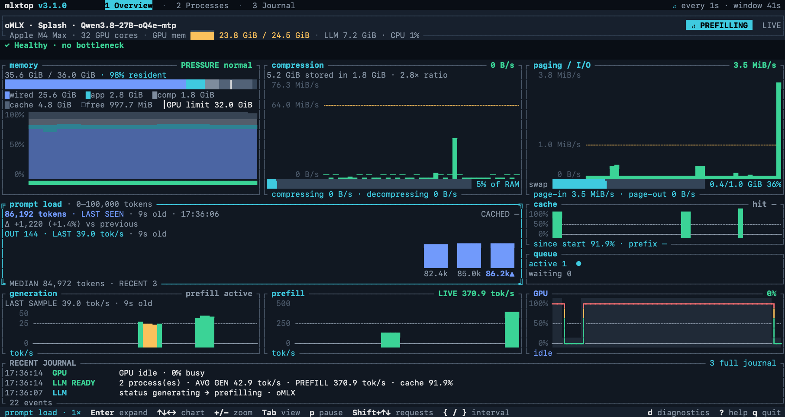

<div align="center">

# mlxtop

**`top` for local LLMs.** See whether memory, paging or the GPU is what's slowing your model down.

[](https://github.com/maximpri/mlxtop/releases/latest)
[](https://github.com/maximpri/mlxtop/actions/workflows/ci.yml)
[](LICENSE)




[Install](#install) · [Quick start](#quick-start) · [Runtimes](#supported-runtimes) · [User guide](docs/USER_GUIDE.md) · [Changelog](CHANGELOG.md)

</div>

When a local model slows down, the cause is usually the machine: memory
pressure, swapping, a full GPU or a throttled card. mlxtop shows those
readings next to your runtime's own numbers, such as tokens per second,
prefill progress, queued requests and cache reuse, so you can see which one
changed when the model slowed.

- **Memory first:** what RAM holds (wired, app, compressed, cache), OS
  pressure, compression and paging, each judged against its warning rate.
- **Live inference:** generation and prefill speed, prompt sizes, cached
  tokens, queues and prefill progress from the runtime itself, never
  estimated from CPU or GPU use.
- **A plain verdict:** a single line reads `✓ Healthy`, or names the problem,
  such as heavy paging, a model partly on the CPU, a full card or heat
  throttling.
- **13 runtimes:** oMLX, Splash, mlx-serve, vLLM, SGLang, llama.cpp, Ollama,
  LM Studio, KoboldCpp and more, detected automatically.
- **Local and read-only:** no sudo, no account, no analytics. It never sends
  prompts or touches your models or runtime settings.

**What's new in 3.1.1:** a Settings tab that edits the config in place and
applies it without a restart, `Esc` asks before quitting, one switch to turn
off alarms, double-click to enlarge a chart, and mlx-serve prefill progress.
3.1 brought a redesigned Overview, `mlxtop update` and oMLX through Splash.
[Release notes →](CHANGELOG.md)

## Install

**Homebrew** (macOS and Linux):

```sh
brew install maximpri/tap/mlxtop
```

**Install script** (macOS on Apple Silicon, Linux x86_64 and ARM64), installs
to `~/.local/bin` without sudo:

```sh
curl -fsSL https://raw.githubusercontent.com/maximpri/mlxtop/main/scripts/install.sh | sh
```

**Windows** (x86_64, PowerShell, no administrator rights needed):

```powershell
irm https://raw.githubusercontent.com/maximpri/mlxtop/main/scripts/install.ps1 | iex
```

Both scripts verify the download's SHA-256 checksum. Linux builds are static
binaries with no runtime dependencies. You can also download a macOS
installer (`.dmg`, unsigned) or an archive from the
[latest release](https://github.com/maximpri/mlxtop/releases/latest).

To update, run `mlxtop update` (`--rc` for release candidates), or
`brew upgrade mlxtop` if you installed with Homebrew.

<details>
<summary>Build from source</summary>

You'll need Rust 1.88 or newer:

```sh
git clone https://github.com/maximpri/mlxtop.git
cd mlxtop
cargo install --path . --locked
```

</details>

## Quick start

```sh
mlxtop            # open the dashboard
mlxtop --once     # print a text report and exit (works over SSH)
mlxtop doctor     # check the runtime connection and which readings are available
```

Memory and GPU readings appear straight away, even with no model loaded. Start
your runtime, send it a prompt, and watch Overview while it answers.

| View | What it shows |
| --- | --- |
| **1 · Overview** | The verdict, memory, compression, paging, prompt load, generation, prefill, GPU, cache, queue and recent events |
| **2 · Processes** | Model processes and the CPU, memory and page-ins each one uses |
| **3 · Journal** | Requests and resource changes during the session |
| **4 · Settings** | Every config option, edited in place and applied without a restart |

| Key | Action |
| --- | --- |
| `1`–`4` / `Tab` | Switch view |
| Arrows / click, `Enter` / double-click | Select a chart, enlarge or restore it |
| `+` `-` / wheel | Zoom chart history |
| `p` / `Space` | Pause sampling |
| `[` `]` | Select an NVIDIA GPU |
| `d` | Diagnostics and setup help for the current runtime |
| `?` / `q` | Help / quit (`Esc` asks first) |

The [user guide](docs/USER_GUIDE.md) explains every chart, its thresholds and
where each reading comes from.

## Supported runtimes

| Runtime | Live speed | What you get |
| --- | :---: | --- |
| [oMLX](docs/USER_GUIDE.md#omlx-telemetry) | ✓ | Models, prompt and generation speed, requests with prefill progress, cache activity; follows oMLX serving through Splash |
| [Splash](https://github.com/incoai/splash) | ✓ | Running and waiting requests, prefill progress, decode and prefill speed, prefix-cache reuse, Metal memory, DFlash acceptance, TTFT |
| [mlx-serve](https://github.com/ddalcu/mlx-serve) | ✓ | Generation and prefill rates, running requests, prefix-cache reuse, MLX memory (start it with `--metrics`) |
| vLLM, SGLang | ✓ | Active and waiting queues, server token rates, KV-cache occupancy, mean first-token time |
| llama.cpp | with `/metrics` | Active slots and output counts; average rates and queues when `/metrics` is enabled |
| KoboldCpp | last request | Input and output counts and rates |
| Ollama | after completion | Loaded models, VRAM, context size, CPU/GPU placement |
| LM Studio | after completion | Loaded instances and context size |
| MLX-LM, LocalAI, Jan, GPT4All | after completion | Process detection and model catalogue |

"After completion" means the speed of each finished request, recorded by the
[usage recorder](docs/USER_GUIDE.md#request-token-telemetry) or the included
[Python helper](scripts/record_usage.py). mlxtop monitors one server at a time;
see [provider endpoints](docs/USER_GUIDE.md#provider-endpoints) for ports,
custom URLs and authentication.

### Platforms

| | macOS (Apple Silicon) | Linux (x86_64, ARM64) | Windows (x86_64) |
| --- | --- | --- | --- |
| Memory pressure | Native | `MemAvailable` and PSI | Commit charge |
| Compression | ✓ | — | — |
| Paging | ✓ | ✓ | Not available from Windows |
| GPU | Apple GPU | NVIDIA via `nvidia-smi` | NVIDIA via `nvidia-smi` |

macOS 11 or later is required. Intel Macs aren't supported.

## Configuration

mlxtop works without configuration. To change the refresh rate, history length,
oMLX endpoint, alarms or warning thresholds, press `4` for **Settings**: changes
apply at once and are saved to `~/.config/mlxtop/config.json`. You can also edit
that file by hand:

```json
{
  "interval": 2,
  "omx": { "host": "127.0.0.1", "port": 8080 }
}
```

Every field and default is listed in the
[configuration reference](docs/USER_GUIDE.md#configuration).

## Limits

- GPU activity covers the whole system, not a single model.
- Polling is sampled, so a request that starts and finishes between two
  samples can be missed.
- mlxtop shows what changed when a model slowed down; it can't prove the
  cause.
- History is kept for the current session only.

## Privacy

mlxtop reads system counters, process information and your runtime's local
APIs. It has no analytics, doesn't upload anything, and by default sends
provider credentials only to endpoints on your own machine. Its local
diagnostic log never contains prompts, model output or API keys. See
[data sources and privacy](docs/USER_GUIDE.md#data-sources-and-privacy) and the
[security policy](SECURITY.md).

## Contributing

Bug reports, documentation fixes and new runtime adapters are welcome. Please
read [CONTRIBUTING.md](CONTRIBUTING.md) first, and open an issue before starting
a large change. When you [report a bug](https://github.com/maximpri/mlxtop/issues),
include the output of `mlxtop --version` and `mlxtop doctor`, plus your OS and
runtime.

mlxtop was developed with the Duet coding agent.

## License

[MIT](LICENSE). Dependencies keep their [own licenses](THIRD_PARTY_NOTICES.md).
mlxtop is an independent project and isn't affiliated with Apple.
